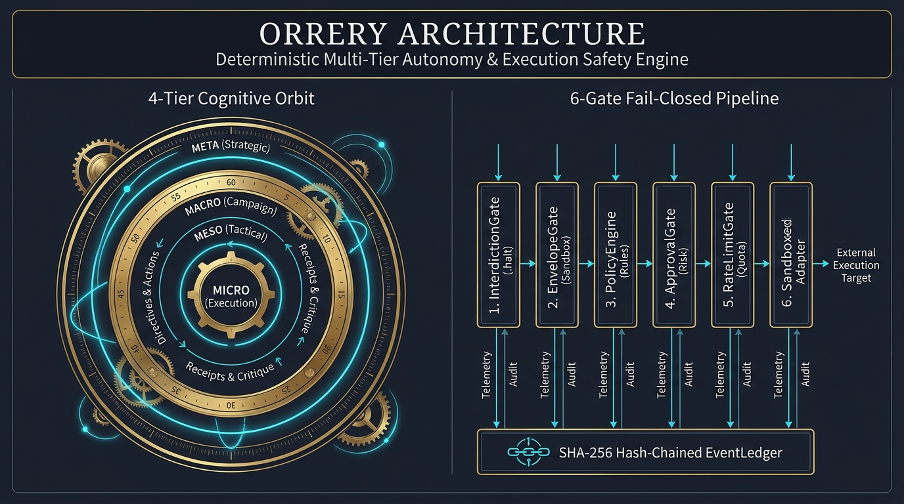

<p align="center">
  
</p>

# Orrery: Multi-Tier Stateful Cognitive Framework

[](https://www.python.org/)
[](LICENSE)
[](https://github.com/kirklasalle/orrery)
[](.antigravity/rules.md)

> *"Outgrowing the basic loop"*

**Orrery** is an agentic framework and orchestration paradigm designed to replace single-step ReAct loops ($\text{Prompt} \rightarrow \text{Tool Call} \rightarrow \text{Observation} \rightarrow \text{Answer}$) with stateful, multi-tier cognitive state loops operating across perception, planning, execution, and reflection.

An orrery is a clockwork model of nested orbits turning at different periods — the same relationship the **Meta**, **Macro**, **Meso**, and **Micro** tiers hold to one another.

```bash
pip install -e ".[dev]"
python examples/demo_cycle.py          # a nested cycle, end to end
python -m orrery.bench                 # does backtracking actually help? measured, not asserted
python -m orrery.tools.attest          # what does this configuration actually permit?
```

```python
from orrery.adapters import FileSystemAdapter
from orrery.core.dispatcher import CycleDispatcher
from orrery.core.types import StateContext, CycleTier

dispatcher = CycleDispatcher()
dispatcher.register_adapter(FileSystemAdapter(root="./workspace"))

context = await dispatcher.run_full_cycle(
    StateContext(goal="Tidy the workspace", tier=CycleTier.MICRO)
)
print(context.status)   # COMPLETED, FAILED, or HALTED — never a fabricated success
```

> ### ⚠️ Project Status: Reference Implementation (Hardened Phases 1–3)
>
> This repository is a **working architectural reference implementation** — verify its boundaries before deploying:
>
> - **Real & Hardened Adapters:** `FileSystemAdapter`, `ProcessAdapter`, `DatabaseAdapter`, `StorageAdapter`, `HttpAdapter`, and `OpenRouterAdapter` are included in `orrery/adapters/` with sandbox confinement, read-only SQL enforcement, SSRF/DNS/redirect filtering, session-isolated process execution, and `ADP-011` fail-closed guards when `is_simulation=False`. The three legacy adapters (`openclaw`, `hermes`, `windows_os`) remain **simulations** under `examples/simulated/`, declare `is_simulation`, and tag every receipt `simulated: True`.
> - An action with no registered adapter now produces a **failed** receipt rather than a fabricated
>   successful one, so an unwired framework reports failure instead of silent success.
> - Every adapter is checked against the **Adapter Conformance Kit** in CI: receipts must echo the
>   request, unsupported actions must fail rather than raise or falsely succeed, and no adapter may
>   stamp its own output as simulated.
> - Actions carry a **risk class**, and the dispatcher refuses to run anything classified
>   `IRREVERSIBLE` without an `ApprovalToken` bound to that exact action. A planner cannot downgrade
>   an action's risk below what its adapter declares.
> - Governance: **2 of the 10 Laws have no runtime control** — Laws 5 and 8, on judicial
>   authority and equity, which a cycle engine making no content decisions cannot evaluate.
>   Laws 1 and 2 are *partial*: Orrery has no harm model, but it will not perform what it cannot
>   undo without explicit consent, and it refuses outright what an operator has declared
>   forbidden. **A cycle cannot act on its own ledger, checkpoints, attestation, keyring, or halt
>   file**, and an operator halt stops it as `HALTED` rather than `FAILED`. What is and is not
>   enforced, and by which test, is documented in [GOVERNANCE.md](GOVERNANCE.md) and gated in CI.
> - **Almost every safety control is off by default.** Signing, attestation, quarantine,
>   envelopes, and invariants are all deployment decisions, and a default install enforces none
>   of them. That is stated here rather than discovered later. `python -m orrery.tools.attest`
>   shows exactly what the running configuration permits, and
>   [config/hardened.yaml](config/hardened.yaml) is the other end of the range — every control
>   on, exercised by `tests/test_hardened_profile.py` so the cost of turning them on is measured
>   rather than assumed.
> - **Adapters are third-party code inside the trust boundary.** The gates constrain *actions*,
>   not adapter implementations. `tests/test_adversarial.py` attacks each gate from a hostile
>   adapter's position and **asserts the attacks that still succeed**, because a defence whose
>   limits are undocumented gets trusted past them.
> - Checkpoints are hash-chained and verified on load. Signing is available in two modes and
>   **off by default**. HMAC (`ORRERY_CHECKPOINT_KEY`, `ORRERY_APPROVAL_KEY`) proves custody of a
>   shared secret the agent also holds. **Ed25519 per-operator signing** proves authorship: the
>   operator keeps a private key the framework never sees, and the framework keeps only a public
>   keyring. Until one is enabled, **an unsigned approval token documents intent, it does not
>   prove consent.**
> - The settings that bound Orrery's authority can be **attested**: digested with the governance
>   registry and signed by an operator, so loosening a limit is an attributable act rather than a
>   quiet edit. It binds configuration, **not the code** — see [GOVERNANCE.md](GOVERNANCE.md).
> - The backtracking claim is now **measured against a control that can falsify it** — see
>   [Benchmark](#-benchmark-does-backtracking-actually-help) below. The same benchmark found a
>   real defect and it has since been fixed: the success-ratio critique used to pass a plan in
>   which one action of four failed, reporting `COMPLETED` for a goal never reached.
>   `SelfCritiqueEngine` now accepts a **goal check** that inspects the world and can only veto;
>   with none supplied, a critique records `goal_verified=None` rather than implying success.
>
> A full technical and governance audit — including reproduced defects, severity ratings, and a
> sequenced remediation plan — is published at [docs/audit_2026-08-06.md](docs/audit_2026-08-06.md).
> Competitive and market positioning is at [docs/competitive_landscape_2026.md](docs/competitive_landscape_2026.md).

---

## 🏗️ Architecture Overview

<p align="center">
  
</p>

```text
orrery/
├── .antigravity/
│   ├── rules.md                  # Agent behavior rules (System 1/2 roles, IDE interface constraints)
│   └── workflows/
│       └── orrery_cycle.yaml      # Antigravity v2 orchestration workflow (Perception -> Deliberation -> Synthesis)
├── config/
│   ├── settings.yaml             # Project settings, thresholds, and storage paths
│   ├── hardened.yaml             # Every control on. Refuses to start until signed for.
│   └── charter_manifest.json     # Pinned digests of the three charter documents
├── docs/
│   ├── PRD.md                    # Product Requirements Document
│   ├── audit_2026-08-06.md       # Full technical & governance audit
│   ├── competitive_landscape_2026.md  # Sourced competitive & market analysis
│   ├── architecture.md           # Technical Architecture Specification
│   ├── setup_guide.md            # Installation & Integration Guide
│   └── archive/                  # Superseded session records, kept as history, not guidance
├── examples/
│   ├── demo_cycle.py             # Executable End-to-End Demonstration Script
│   └── simulated/                # openclaw, hermes, windows_os — fabricate results, outside the package
├── orrery/
│   ├── core/                     # Dispatcher, checkpoints, critique, ledger, and the gates:
│   │                             #   approval, interdiction, envelope, quarantine, invariants,
│   │                             #   signing, attestation, charter, hindsight
│   ├── cycles/                   # Hierarchical Tiers (MetaCycle, MacroCycle, MesoCycle, MicroCycle)
│   ├── adapters/                 # Bundled adapters: FileSystem, Process, Database, Storage, HTTP, OpenRouter
│   ├── bench/                    # Backtracking benchmark: tasks graded against the disk
│   └── tools/                    # Operator CLIs: keygen, attest, charter, quarantine, propose
├── tests/                        # Pytest Suite, incl. adversarial and hardened-profile gates
├── GOVERNANCE.md                 # Which Laws are enforced, by what, and proven by which test
├── SECURITY.md                   # Threat model and disclosure. The boundary is the process.
├── CONTRIBUTING.md               # The documentation is executable; PRs update the claim too
├── CHANGELOG.md
├── LICENSE
├── .gitignore
├── pyproject.toml
└── README.md
```

### Documents worth reading before the code

| | |
| --- | --- |
| [GOVERNANCE.md](GOVERNANCE.md) | Every Law, what enforces it, and the test that proves it. Says plainly that **2 of the 10 have no runtime control**. CI fails if it claims more than the code does. |
| [SECURITY.md](SECURITY.md) | The threat model, and what is deliberately **out of scope**: the security boundary is the process, not the gate ladder. |
| [CONTRIBUTING.md](CONTRIBUTING.md) | The property nobody guesses — four documents are CI gates, so a PR that changes behaviour updates the governance claim in the same commit. |
| [docs/developer_guide.md](docs/developer_guide.md) | Comprehensive engineering guide: architecture, custom adapters, custom gates, cycle implementations, Ed25519 signing, state checkpointing, and testing standards. |
| [docs/user_guide.md](docs/user_guide.md) | Operator guide: installation, cycle tiers, 5-gate defense-in-depth stack, environment config, practical tutorials, and troubleshooting. |
| [docs/audit_2026-08-06.md](docs/audit_2026-08-06.md) | The full audit, with findings marked resolved or still open. Nothing is quietly closed. |
| [docs/competitive_landscape_2026.md](docs/competitive_landscape_2026.md) | Sourced analysis, including where LangGraph, Reflexion, and CoALA already occupy this space. |

---

## ⚡ Key Architecture & Features

### 1. 4-Phase State Machine Dispatcher

Transitions deterministically through:

- **PERCEPTION**: Environmental sensing & hypothesis generation (System 1).
- **PLANNING**: Strategy formulation & constraint evaluation (System 2).
- **EXECUTION**: Adapter action dispatch & receipt collection.
- **REFLECTION**: Quantitative self-critique gate ($\theta_{\text{critique}} = 0.70$).

### 2. 4 Hierarchical Abstraction Tiers

- **Meta-Cycles**: High-level system strategy and agent goal alignment.
- **Macro-Cycles**: Multi-step workflow orchestration and milestone tracking.
- **Meso-Cycles**: Context-bound execution loops and tool sequence management.
- **Micro-Cycles**: Fine-grained atomic actions and visual/text observation verification.

### 3. Built-in Meta-Skills

- **Disk-Backed State Checkpointing**: Immutable point-in-time state snapshots (`StateContext`) persisted to `.checkpoints/`, SHA-256 hash-chained and verified on load.
- **Automated Backtracking**: Rewinds execution state back to safe checkpoints upon reflection failure, carrying lessons forward so the retry is informed rather than identical.
- **Agent Self-Critique**: Quantitative scoring ($0.0 - 1.0$) over execution receipts, **plus an optional `goal_check`** that inspects the world and can only veto — because a success ratio measures whether adapters obeyed, not whether anything was accomplished.
- **Hindsight**: reads the ledger's abandoned attempts and drafts constraints for operator review. See [above](#learning-constraints-from-what-was-abandoned).

### 4. Enterprise Integration Adapters

All six built-in adapters in `orrery/adapters/` enforce `sandbox_roots()` visibility, risk classification, and `ADP-011` fail-closed errors when `is_simulation=False`:

- **[FileSystemAdapter](orrery/adapters/filesystem.py)**: Real sandboxed file I/O with canonical `Path.resolve().is_relative_to(...)` confinement.
- **[ProcessAdapter](orrery/adapters/process.py)**: Allowlisted `shell=False` subprocess runner with OS session isolation, clamped timeouts, and incremental output byte caps (`run_program` is declared `IRREVERSIBLE`).
- **[DatabaseAdapter](orrery/adapters/database.py)**: SQLite adapter with sandbox path confinement and read-only SQL enforcement (`?mode=ro`, `PRAGMA query_only = ON`, single-statement `SELECT` validation).
- **[StorageAdapter](orrery/adapters/storage.py)**: Object-storage adapter with canonical bucket/key confinement across sources and `copy_object` destinations.
- **[HttpAdapter](orrery/adapters/http.py)**: REST adapter with domain allowlists, private/loopback/link-local/RFC 1918 IP & DNS blocking, redirect-hop re-validation, and `asyncio.to_thread` execution.
- **[OpenRouterAdapter](orrery/adapters/openrouter.py)**: Governed LLM inference adapter with model allowlists, token caps, and `is_simulation` / `api_key` fail-closed checks.

Three simulated adapters (`openclaw`, `hermes`, `windows_os`) live in
[examples/simulated/](examples/simulated) rather than in the package, so a simulation cannot be
imported by reflex while scanning for integrations. They declare `is_simulation`, tag every
receipt `simulated: True`, and are **refused registration** unless `adapters.allow_simulated` is
switched on.

---

## 🔐 Operator identity, approval, and attestation

Two kinds of signature, proving two different things:

| | HMAC-SHA256 | Ed25519 |
| --- | --- | --- |
| Configured by | `ORRERY_APPROVAL_KEY` / `ORRERY_CHECKPOINT_KEY` | `ORRERY_OPERATOR_ID` + `ORRERY_OPERATOR_PRIVATE_KEY` |
| Verifier needs | the same secret | only a public keyring |
| Therefore proves | **custody** | **authorship** |

The agent process holds the HMAC secret, so an HMAC signature cannot distinguish a human
operator from the code asking for permission. Ed25519 can, because verifying and signing are
different capabilities. Set `approval.require_asymmetric` and a *valid* HMAC token is refused.

```bash
# Create an operator identity. The private key is written to a file, never printed.
python -m orrery.tools.keygen --operator alice

# Approve the settings that bound Orrery's authority, plus the governance registry itself.
python -m orrery.tools.attest --show      # exactly what is covered
python -m orrery.tools.attest --sign --note "reviewed for production"

# Later, after somebody edits a limit:
python -m orrery.tools.attest
# Attestation: INVALID — configuration has changed since it was approved by 'alice'
```

With `governance.require_attestation` on, a dispatcher **refuses to construct** on an unattested
configuration. This binds configuration and policy declarations, not the code — anyone who can
edit the source can delete the check. It raises the cost of a silent configuration change; it is
not a substitute for controlling who can deploy.

On a machine that only needs to verify, set `ORRERY_OPERATOR_KEYRING` alone and withhold the
private key. A process that cannot sign cannot forge consent.

### Charter integrity

The 10 Laws are written out in full in three documents, which is a drift machine — and it had
already drifted. When the Fourth Law's "conforms to" was corrected to "violates" (as written, it
forbade *compliance*), the fix landed in two documents and not the third.

```bash
python -m orrery.tools.charter           # compare all three, verify pinned digests
python -m orrery.tools.charter --show    # print the canonical 10 Laws
python -m orrery.tools.charter --update  # re-pin, after a deliberate change
```

`AGENTIC_PRIME_DIRECTIVE.md` is canonical. The others are compared to it Law by Law — tolerant of
case, whitespace, and dash style, intolerant of word choice — and every file's digest is pinned in
`config/charter_manifest.json`. Both are CI gates, and the charter digest is folded into the
attestation, so approving a configuration approves the charter it runs under.

---

## 🚪 How an action gets stopped

Every action passes a ladder of gates, each answering a different question. A later gate can
never answer an earlier one's:

| Gate | Question | Policy |
| --- | --- | --- |
| **Interdiction** | Is this *forbidden*? | `LAW1-PROHIBIT`, `LAW3-SUBORDINATE` |
| **Envelope** | Does it reach outside what may be touched? | `LAW1-ENVELOPE` |
| **Quarantine** | Can it even be characterised? | `LAW1-QUARANTINE` |
| **Approval** | Is it understood, and does a human consent? | `RISK-001`…`RISK-005` |
| **Rate Limit** | Is the action within per-minute frequency ceilings? *(after Approval)* | `RATE-001` |
| **Invariants** | Is the *pattern* pathological? *(after the fact)* | `LAW10-INVARIANT` |

The first four refuse before anything runs. The fifth does not — see below.

### Actions nobody anticipated

All of the above except one are *enumerative*: they match lists written in advance, and are
therefore silent about an action invented next year. Three mechanisms address that directly.

**Fail closed on the unknown.** An action its adapter never declared is not assumed harmless. It
is `IRREVERSIBLE` by default — or, with quarantine on, **held**.

**Quarantine.** Approval and quarantine answer different questions. `RISK-001` asks "this is
`IRREVERSIBLE`, may I?", where the system understands the action and needs consent. Quarantine
asks "I cannot characterise this at all." Releasing a held action requires a **classification** —
a statement of what it *is*, signable by an operator — not a permission. **A classification never
authorises:** one classified `IRREVERSIBLE` still needs an approval token bound to each specific
action.

```bash
python -m orrery.tools.quarantine        # what is held, and why
python -m orrery.tools.quarantine --classify notes:purge --risk COMPENSABLE --note "moves to trash"
```

**Effect envelopes.** The only non-enumerative control. An adapter declares the boundary of what
it will ever touch; a deployment declares what anything may touch here. Both must permit, so the
effective envelope is their **intersection** and can only be narrower than either. A brand-new
action is judged by *where it lands* — nobody has to have heard of it.

**Ledger invariants** catch what no single action reveals: no individual read is exfiltration, ten
thousand in three seconds is. They run over the append-only ledger, which retains the attempts
backtracking discarded. **This is detection, not prevention** — an invariant fires *after* the
breaching action has run. Set to halt, it stops the next one. That is containment, and calling it
anything else would be false.

### Learning constraints from what was abandoned

Every control above is enumerative, and they share one wall: somebody has to think of the rule in
advance. The ledger removes that wall from the other side. Because it lives outside rewindable
state it **retains the attempts backtracking erased** — data a framework storing history inside
agent state destroys — so Orrery can read its own past and draft constraints from it:

```bash
python -m orrery.tools.propose
```

```text
  notes:purge_notes  [prohibition]
    because:  refused 14 times and never once permitted; if it is never to be allowed,
              say so explicitly instead of refusing it repeatedly
    evidence: 14 occurrence(s) across 6 cycle(s); events 88, 104, 119...
```

**A proposal is inert** — unsigned, unenforced, with no path into the gates. Enacting one is an
operator action through the ordinary signing path. A classification's risk is deliberately left
blank, because repetition shows an action *recurs* and says nothing about what it *does*. A
pattern is a reason to look, not a reason to forbid.

---

## 🛡️ Threat model: what the gates are, and are not

**The security boundary is the process, not the gate ladder.**

Adapters are ordinary Python objects running in the same process as the dispatcher, with the
same privileges. Every gate above inspects an **action** — a data structure an adapter is asked
to handle. An adapter that does its real work without routing it through an action is outside
all of them, and no in-process check can change that.

So be precise about what the ladder buys you:

| Against | Effective? |
| --- | --- |
| Planner mistakes, runaway loops, mis-scoped goals | **Yes.** This is what it is for. |
| An honest adapter used carelessly or configured too broadly | **Yes.** |
| An adapter that under-declares its actions or risks | **Partly.** Fails closed, quarantines, and the conformance kit surfaces it. |
| An adapter that *mis*-declares — says a delete is read-only | **No.** The approval gate believes it. Envelopes and prohibitions do not, which is why they exist. |
| Deliberately hostile adapter code | **No.** It can bypass every gate by not using actions. |

[tests/test_adversarial.py](tests/test_adversarial.py) attacks each gate from a hostile adapter's
position and **asserts the attacks that still succeed**, so these limits are executable rather
than promised.

**If you will run adapters you do not trust,** put them in a separate process with OS-level
confinement — a container, a jail, a restricted user, seccomp — and treat this ladder as defence
in depth *inside* that boundary, not as the boundary itself. Orrery bounds what a cycle asks for.
Only the operating system bounds what a process can do.

Two further things worth stating plainly: **Orrery has had no external security review**, and
**almost every control here is off by default** — see [config/hardened.yaml](config/hardened.yaml)
for the other end of the range, and run `python -m orrery.tools.attest` to see what your running
configuration actually permits.

---

## 🚀 Quickstart & Testing

```bash
# Clone & install repository
git clone https://github.com/kirklasalle/orrery.git
cd orrery

# Create the canonical environment (Python 3.10)
python -m venv .venv
.venv\Scripts\activate        # Windows
# source .venv/bin/activate   # macOS / Linux

pip install -e ".[dev]"

# Run unit test suite
pytest tests/ -v

# Run executable demonstration script
python examples/demo_cycle.py

# Run formal gate composition soundness verification (THM-01..THM-05)
orrery verify

# Verify charter document digests
orrery charter

# Launch the Governance Console & Real-Time 3D WebGL Gyroscope
orrery dashboard --open --gyroscope

# Measure the backtracking claim
python -m orrery.bench
```

---

## 🌀 Real-Time 3D WebGL Gyroscope & Universal Plugin

### 3D WebGL Gyroscope Studio (`/gyroscope`)

`GovernanceDashboardServer` serves both the audit console (`/`) and an interactive PBR **3D WebGL Gyroscope** ([orrery/web/gyroscope.html](orrery/web/gyroscope.html)) at `/gyroscope`, synced in real time over Server-Sent Events (`/api/stream`):

- **4-Tier Nested Gimbal Kinematics:** `META` (Strategic) → `MACRO` (Campaign) → `MESO` (Tactical) → `MICRO` (Execution flywheel core).
- **6-Gate Orbital Checkpoints:** Real-time telemetry pulses traverse the 6 gate pylons into the `SHA-256 Hash-Chained EventLedger` base ring, flashing crimson on interdiction/refusal.
- **Studio Controls & Video Export:** On-page RPM, precession, tier-explode, camera presets, and built-in **60 FPS `.webm` video capture** + PNG still export.

### Universal Agent & Harness Plugin

Orrery ships both as a standalone Python package (`[project.scripts]`: `orrery`, `orrery-mcp`, `orrery-dashboard`) and as a **universal plugin bundle** compatible with Antigravity, Claude Code, Cursor, Codex, and Gemini CLI:

- **Manifest & Assets:** [plugin.json](plugin.json), [assets/logo.svg](assets/logo.svg)
- **MCP Server Config:** [mcp_config.json](mcp_config.json) / [.mcp.json](.mcp.json) (`orrery-governance` running `python -m orrery.cli mcp`)
- **Agent Skill & Rules:** [skills/orrery-governance/SKILL.md](skills/orrery-governance/SKILL.md), [rules/AGENTS.md](rules/AGENTS.md)

---

## 📈 Benchmark: does backtracking actually help?

Orrery's central claim is that checkpoint-and-rollback with retained lessons makes long-horizon
work more reliable. [`orrery/bench`](orrery/bench) exists so that claim can be shown to be false.

Six tasks run against the real `FileSystemAdapter`. Each one's first attempt fails for a reason
the adapter or a governance policy genuinely produces — a real `FileExistsError`, a real sandbox
refusal, a real `RISK-001` approval denial — and **every run is graded by reading the sandbox
afterwards, never by trusting a receipt.**

Three arms share one attempt budget, and a fourth prices the harness's own assumption:

| Arm | Rollback | Lessons retained | Goal check |
| --- | --- | --- | --- |
| `single_pass` | no | — | yes |
| `blind_retry` | yes | **no** | yes |
| `unverified` | yes | yes | **no** |
| `backtrack` | yes | yes | yes |

`blind_retry` is the arm that matters for the thesis. Beating `single_pass` would only show that
retrying beats not retrying, which nobody disputes. The falsifiable claim is that *informed*
rollback beats *uninformed* rollback at an identical budget, and the planner may branch on
`context.lessons` and nothing else — so in `blind_retry` every attempt repeats the first exactly.

Each task's verifier is also wired in as the cycle's `goal_check`, so reflection can tell whether
the goal was reached rather than only whether the adapters behaved. **A real deployment has to
write that check itself**, so `unverified` keeps everything else and drops only the oracle, which
prices the assumption instead of merely disclosing it.

Current result (2 trials, 6 tasks):

```text
arm             verified  claimed  false  attempts  actions  seconds
single_pass      0/12           0      0        12       18     0.14
blind_retry      0/12           0      0        48       72     0.47
unverified       8/12          10      2        26       38     0.26
backtrack       10/12          10      0        28       48     0.33

VERDICT: SUPPORTED
Goal check is worth 2 task(s): the harness supplies one, a deployment has to write it.
```

Read the columns honestly:

- **Verified** is the only success measure. `backtrack` solves five tasks that `blind_retry`
  solves zero of, while spending barely half the attempts — blind retry burns its whole budget
  on plans it has already watched fail.
- **False** counts runs that reported `COMPLETED` while the disk disagreed. It is zero in the
  shipped configuration, and **two without a goal check**. That is the price of the oracle,
  measured: `silent_partial_failure` has three of four actions succeed, so success-ratio
  critique scores 0.75 against a 0.70 threshold, passes, and certifies a goal it never checked.
- `unreachable_target` is unsolvable by design. Every arm fails it and none claims otherwise,
  which is what the cost columns are for: retrying something hopeless is pure expense.

The result is a measurement of these six tasks under this planner. It is **not** a claim about
OSWorld, SWE-bench, or τ-bench, none of which Orrery has been run against — that remains the
largest open item in [docs/audit_2026-08-06.md](docs/audit_2026-08-06.md).

```bash
python -m orrery.bench --list              # describe the suite
python -m orrery.bench --trials 5          # more trials
python -m orrery.bench --json report.json  # full per-run detail
```

---

## 📊 Market Research & Strategic Audit

For competitive and market positioning, see [docs/competitive_landscape_2026.md](docs/competitive_landscape_2026.md),
which cites MarketsandMarkets and Precedence Research directly.

> ⚠️ The earlier `market_research_audit.md` has been moved to
> [docs/archive/](docs/archive) and marked **SUPERSEDED — DO NOT CITE**. Its market figures are
> unsourced and not traceable to any published research.

---

## 🔗 Repository & Remote Integration

Remote repository target: `https://github.com/kirklasalle/orrery.git`

```powershell
git remote add origin https://github.com/kirklasalle/orrery.git
git push -u origin main
```
