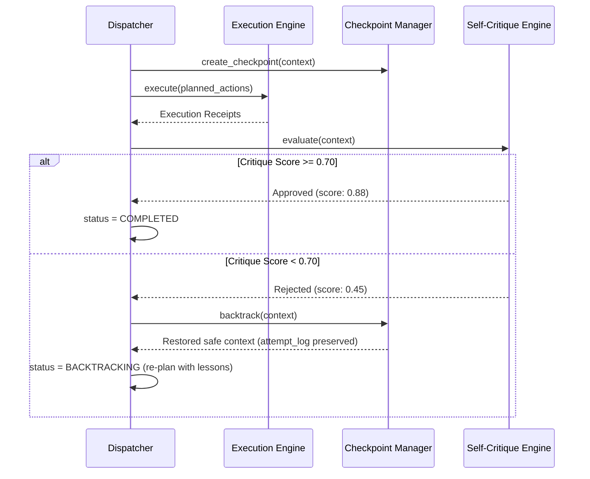

# Orrery User Guide

> **Target Audience:** System Operators, AI Engineers, and Security Administrators  
> **Version:** 1.0.0  
> **Status:** Active Reference  

---

## 1. What is Orrery?

**Orrery** is an enterprise-grade cognitive-governance runtime for autonomous AI agents. Unlike standard AI frameworks that execute raw model tool calls directly against operating systems, Orrery wraps every agent action in a multi-tiered cognitive state machine and a deterministic 5-stage defense-in-depth safety pipeline.

### Why Orrery?
- **Zero Raw Execution**: Models never invoke bash, powershell, or filesystem APIs directly. All actions pass through cryptographically validated envelopes.
- **Tamper-Evident Ledger**: Every action and output receipt is chained into an immutable SHA-256 Merkle hash chain.
- **Self-Healing Backtracking**: When actions fail or quality scores drop below thresholds ($\theta_{\text{critique}} = 0.70$), Orrery automatically rewinds state to the last safe checkpoint while retaining the memory of the failure.
- **Enterprise Compliance**: Built with NIST AI Risk Management Framework (AI RMF) and zero-trust principles at its core.

---

## 2. Installation & Quick Start

### Prerequisites
- **Python 3.10 or higher**
- Supported Platforms: **Windows (x64)**, **Linux (Ubuntu/Debian, RHEL)**, **macOS (Apple Silicon & Intel)**

### Installation

```bash
# Clone the repository
git clone https://github.com/kirklasalle/orrery.git
cd orrery

# Create and activate virtual environment
python -m venv .venv

# Windows PowerShell:
.venv\Scripts\Activate.ps1
# Linux / macOS:
source .venv/bin/activate

# Install Orrery
pip install -e .
```

### Running Your First Governed Cycle

You can run an atomic Micro-Cycle directly from the command line:

```bash
python -m orrery.cycles.micro
```

**Expected Output:**
```text
=== MicroCycle Execution ===
Cycle ID: micro_20260906_142010_3914a2
[Phase: PERCEPTION] Parsing environment cues and goal state...
[Phase: PLANNING]   Synthesizing action payloads and checking constraints...
[Phase: EXECUTION]  Evaluating Gate Stack -> All 5 Gates Passed (Verdict: ALLOW)
                    Dispatching to Adapter -> Execution Successful
[Phase: REFLECTION] Computing Self-Critique Score: 0.92 (Threshold: 0.70)
Cycle Status: COMPLETED
Ledger Block #1 committed (Hash: e3b0c44298fc1c149afbf4c8996fb924...)
```

---

## 3. Core Concepts

### 3.1 Cognitive Cycle Hierarchy

Orrery breaks complex multi-hour agent workflows into four nested cognitive abstraction tiers:

| Tier | Name | Typical Horizon | Primary Function |
|:---|:---|:---|:---|
| **Tier 1** | **Meta-Cycle** | Hours / Days | High-level organizational strategy, multi-agent governance, charter alignment. |
| **Tier 2** | **Macro-Cycle** | 10–60 Minutes | Multi-step milestone planning, sub-task sequencing, and artifact synthesis. |
| **Tier 3** | **Meso-Cycle** | 1–10 Minutes | Context-bound operational loops, tool management, and iterative refinement. |
| **Tier 4** | **Micro-Cycle** | Seconds / Atomic | Direct tool invocation, command execution, or atomic state verification. |

### 3.2 The 5-Gate Governance Stack

Every action request emitted by any cycle tier must pass five sequential gates before reaching the physical adapter:

1. **Gate 1: Charter Directive Gate**  
   Verifies that the requested action does not violate the inviolate directives specified in `Permanent_Active_Directives.txt` (e.g., unauthorized privilege escalation, uncontained process spawning, or safety perimeter breaches).
2. **Gate 2: Capability Gate**  
   Verifies that the calling agent role possesses the cryptographic capability token required for this specific action (e.g., `fs:write`, `proc:spawn`).
3. **Gate 3: Parameter & Safety Gate**  
   Sanitizes all arguments, blocking path traversal attacks (`../`), unauthorized environment variable overrides, and dangerous shell metacharacters.
4. **Gate 4: Rate & Resource Gate**  
   Enforces call-frequency ceilings, memory allowances, and execution time quotas to prevent resource exhaustion or rogue runaway loops.
5. **Gate 5: Cryptographic Attestation Gate**  
   Verifies that the incoming envelope is signed by an active, recognized key in the trusted `Keyring` with a valid Ed25519 signature.

---

## 4. Configuration & Environment Reference

Orrery is configured via environment variables or through an optional `.env` file in your workspace root.

### Core Settings

| Environment Variable | Default | Description |
|:---|:---|:---|
| `ORRERY_GOVERNANCE_MODE` | `strict` | Enforcement mode: `strict` (fail-closed), `permissive` (warnings only), or `audit_only`. |
| `ORRERY_STORAGE_DIR` | `./.storage` | Root directory for runtime state and session data. |
| `ORRERY_CHECKPOINT_DIR` | `./.checkpoints` | Directory storing JSON serialized state snapshots. |
| `ORRERY_LEDGER_DIR` | `./.ledger` | Directory storing append-only audit ledger blocks. |
| `ORRERY_THETA_CRITIQUE` | `0.70` | Minimum score threshold ($0.0 - 1.0$) required to pass the Reflection phase. |
| `ORRERY_MAX_BACKTRACKS` | `3` | Maximum number of automated backtracks allowed before marking a cycle `FAILED`. |
| `ORRERY_SIGNING_KEY_PATH` | *None* | Path to the private Ed25519 key file for agent signing. |
| `ORRERY_KEYRING_PATH` | *None* | Path to the JSON keyring file containing trusted public keys. |

---

## 5. Practical Operator Tutorials

### Tutorial 1: Governed Process Execution

To run local operating system commands with full governance, process tree tracking, and safe timeout enforcement:

```python
import asyncio
from pathlib import Path
from orrery.adapters.process import ProcessAdapter

async def main():
    # Initialize adapter with an allowed working root
    adapter = ProcessAdapter(working_dir=Path("./sandbox"))

    # Execute a command safely
    receipt = await adapter.execute(
        action="exec:run",
        parameters={
            "command": ["python", "--version"],
            "timeout_seconds": 10.0
        }
    )

    print(f"Success: {receipt.success}")
    print(f"Stdout: {receipt.output.get('stdout')}")
    print(f"Receipt Hash: {receipt.receipt_hash}")

if __name__ == "__main__":
    asyncio.run(main())
```

### Tutorial 2: Governed File Access with Confinement

The `FileSystemAdapter` strictly confines all read/write operations to an allowed root directory, preventing any path traversal or out-of-bounds writes:

```python
import asyncio
from pathlib import Path
from orrery.adapters.filesystem import FileSystemAdapter

async def main():
    root = Path("./workspace_data").resolve()
    fs = FileSystemAdapter(base_dir=root)

    # Safe write
    write_receipt = await fs.execute(
        action="fs:write",
        parameters={"path": "report.txt", "content": "Analysis complete."}
    )
    print("Write receipt:", write_receipt.success)

    # Attempted path traversal (Will be blocked)
    bad_receipt = await fs.execute(
        action="fs:write",
        parameters={"path": "../../etc/passwd", "content": "attack"}
    )
    print("Path traversal blocked:", bad_receipt.success is False)
    print("Security error:", bad_receipt.error)

if __name__ == "__main__":
    asyncio.run(main())
```

### Tutorial 3: Verifying Audit Ledger Integrity

To verify that the ledger has not been modified or truncated by an attacker:

```python
from orrery.core.ledger import AuditLedger

def verify_system_ledger():
    ledger = AuditLedger(storage_dir="./.ledger")
    is_valid, error_msg = ledger.verify_chain()
    
    if is_valid:
        print("✅ Audit ledger is 100% cryptographically intact.")
    else:
        print(f"❌ TAMPERING DETECTED: {error_msg}")

if __name__ == "__main__":
    verify_system_ledger()
```

---

## 6. Self-Healing & Backtracking

When an agent's execution produces poor results or encounters an environmental fault, Orrery prevents system lock-up via **Automated Backtracking**:



### What Happens During Backtracking?
1. **Context Snapshot Restored**: State variables, working hypotheses, and temporary buffers are restored to the last valid checkpoint.
2. **Failure Lessons Retained**: The `attempt_log` and `lessons` arrays are **not** wiped; they are carried forward into the new planning phase so the model understands why the previous attempt failed and selects an alternative approach.
3. **Loop Guard**: If a cycle exceeds `ORRERY_MAX_BACKTRACKS` (default: 3), execution is halted and flagged for human-in-the-loop review.

---

## 7. Troubleshooting & FAQs

### Common Error Codes

#### `GateInterdictionError: Charter directive violation`
- **Cause**: The planned action violates an inviolate directive in `Permanent_Active_Directives.txt`.
- **Remedy**: Verify your action parameters. Ensure the agent is not trying to bypass security boundaries, elevate privileges, or access unapproved network domains.

#### `KeyringVerificationFailed: Unknown key_id`
- **Cause**: The incoming action envelope was signed by a `key_id` not present in the active `Keyring`.
- **Remedy**: Add the public key to your keyring via `keyring.add(key_id, public_key_hex)` or ensure `ORRERY_KEYRING_PATH` points to the authorized keyring file.

#### `BacktrackLimitExceeded`
- **Cause**: The agent failed reflection 3 consecutive times on the same milestone.
- **Remedy**: Check the `attempt_log` in the cycle context to review the exact self-critique feedback. Adjust the task description, loosen overly strict constraints, or inspect whether external APIs or tools are down.

---

## 8. Security & Compliance Best Practices

1. **Air-Gapped Operation**: For high-assurance environments, run Orrery in an air-gapped container with local weights or a private OpenRouter / vLLM endpoint.
2. **Read-Only Root Filesystems**: Mount host directories as read-only, giving the agent write privileges exclusively to designated, monitored sandbox paths.
3. **Key Separation**: Keep private signing keys on secure hardware or environment secret managers. Never commit private keys to version control.
4. **Regular Ledger Auditing**: Schedule automated cron jobs to run `verify_chain()` on `.ledger/` and stream alerts to your central SIEM (e.g., Datadog, Splunk, or CloudWatch).

---

## 9. Regulatory Compliance Auditing

Orrery includes an automated compliance scanner that audits your active configuration, cryptographic keys, charter manifest, and ledger records against leading frameworks:

- **NIST AI Risk Management Framework 1.0 (NIST AI 100-1)**
- **White House OMB M-24-10** (Federal AI Governance)
- **Colorado SB 24-205** (Artificial Intelligence Act)
- **California AB 2013 / Safety Directives**
- **EU AI Act Articles 12-15** (Record-keeping, transparency, human oversight)

### Running an Audit:

```bash
# Generate a full Markdown briefing with gap analysis and remediation plan:
python -m orrery.tools.compliance --framework all --format markdown --output audit_report.md

# Generate machine-readable JSON for automated compliance monitoring:
python -m orrery.tools.compliance --framework nist --format json

# Enforce strict compliance in CI (fails with exit code 1 if any gaps found):
python -m orrery.tools.compliance --framework omb --strict
```

---

## 10. Calibrating Reflection Thresholds ($\theta_{\text{critique}}$)

To ensure the agent neither accepts partial failures nor rejects valid completions, run the empirical calibration tool:

```bash
# Calibrate for fail-closed governance (minimizes False Positives / unearned passes):
python -m orrery.tools.calibrate_critique --objective fail_closed

# Calibrate for balanced throughput (optimizes F1 score):
python -m orrery.tools.calibrate_critique --objective balanced
```

Recommended default: **$\theta = 0.80$** (yields 0.0% False Positive Rate on benchmark verification).

---

## 11. OpenRouter & LLM-as-a-Judge Configuration

To enable LLM inference or an out-of-band LLM-as-a-judge goal check:

```bash
# Export your OpenRouter API key
export OPENROUTER_API_KEY="sk-or-v1-..."
```

When no API key is supplied, the OpenRouter adapter automatically runs in **simulation / air-gapped mode**, providing deterministic test responses without failing.

---

## 12. Working with Real-World Production Adapters

Orrery includes adapters for governed interaction with external services:

### 12.1 HTTP/REST Adapter
Governs outbound web requests, automatically enforcing domain allowlists and blocking cloud metadata SSRF attempts:
- **Actions**: `get`, `head`, `post`, `put`, `patch`, `delete`.
- **Approval Mandate**: `delete` actions are classified as `IRREVERSIBLE` and trigger approval gate scrutiny.

### 12.2 Relational Database Adapter
Executes SQL queries against relational databases with statement-level risk classification:
- **Actions**: `query` (SELECT), `execute` (INSERT/UPDATE), `execute_destructive` (DELETE/DROP), `list_tables`, `table_info`.
- **Read-Only Mode**: Set `read_only=True` to guarantee no write or drop operations execute.

### 12.3 Cloud & Object Storage Adapter
Interacts with S3/GCS-compatible object storage with multi-tenant prefix boundaries:
- **Actions**: `get_object`, `list_objects`, `stat_object`, `put_object`, `copy_object`, `delete_object`, `delete_bucket`.
- **Security Boundaries**: Path traversal (`..`) in object keys is automatically blocked by the envelope gate.


